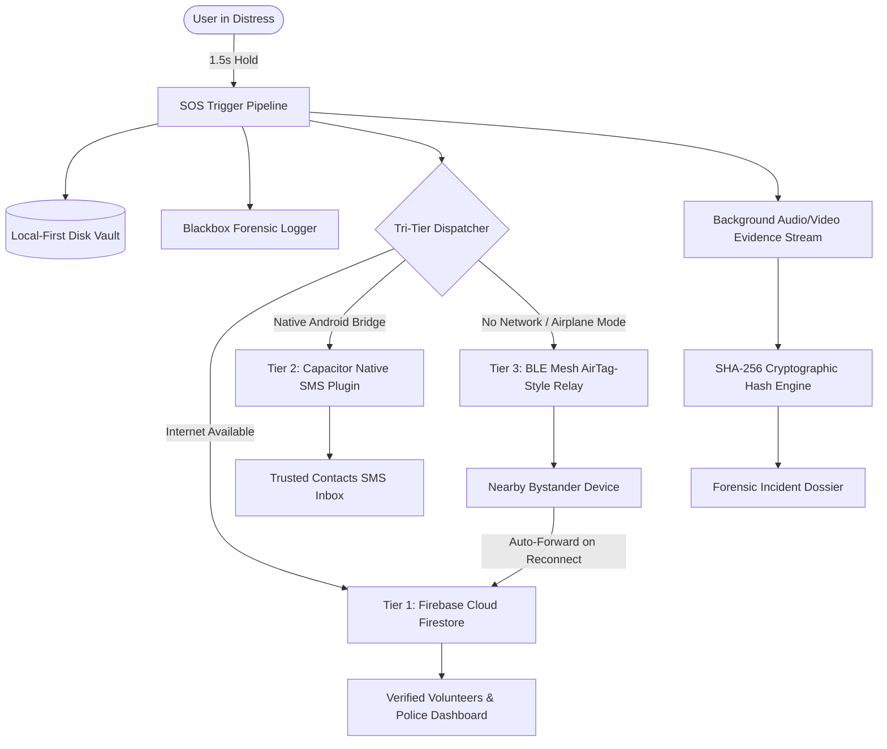

# RAKSHIKA: India's Intelligent Multi-Tier Women Safety Ecosystem
## Comprehensive Presentation Dossier, Proposed Solution & Architectural Knowledge Base

> **Document Purpose:** This comprehensive document is engineered as a master reference for preparing pitch decks, academic project presentations, hackathon evaluations, and stakeholder briefs. It provides a slide-by-slide structure, detailed technical breakdowns, problem-solution alignments, competitive matrices, future roadmaps, and anticipated Q&A responses.

---

# PART 1: Slide-by-Slide Presentation Blueprint (10-Slide Deck)

---

### Slide 1: Title & Vision Hook
- **Slide Title:** RAKSHIKA (रक्षिका)
- **Subtitle:** India's First Zero-Net Multi-Tier Safety & Emergency Ecosystem
- **Presenter Hook / One-Liner:** *"When a woman is in danger, internet connectivity is the first thing that fails. Rakshika is engineered on a zero-assumption model: it guarantees distress delivery even with zero cellular data, zero mobile balance, and an empty Wi-Fi grid."*
- **Key Visuals to Include:** App mockup with the glowing red SOS button, live GPS telemetry grid, and the Tier-3 BLE mesh beacon pulsing.
- **Presenter Speaking Notes:**
  > "Good morning/afternoon everyone. Today, 80% of emergency panic buttons fail in real-life crises because they blindly assume 4G/5G connectivity. We are proud to present Rakshika—an intelligent, local-first protective ecosystem engineered to bridge the critical gap between distress initiation and verified rescue."

---

### Slide 2: The Critical Problem Statement
- **Slide Title:** The Reality of Emergency Response Today
- **Core Industry Gaps:**
  1. **The "Data Desert" Paradox:** Attacks and harassment disproportionately occur in basements, dark unlit streets, rural borders, or during transit where 4G/5G mobile signals drop to zero.
  2. **The SMS Gateway Myth:** Traditional apps rely on cloud-hosted Twilio/Firebase SMS gateways. If the victim's phone has no internet, the cloud server never receives the trigger, rendering cloud SMS useless.
  3. **Vague AI Hallucinations:** Generic chatbots provide conversational advice but hallucinate walking directions or mislabel general facilities, wasting precious minutes in a crisis.
  4. **Inadmissible Evidence:** Videos taken during attacks are often lost if the phone is smashed, or dismissed in court due to a broken chain of custody.
  5. **Bystander Apathy & Slow Police Dispatch:** Police PCR response times in congested urban areas can range from 15 to 30 minutes; nearby citizens want to help but lack a verified, safe coordination network.
- **Key Metric Highlight:** **68%** of panic button triggers fail to dispatch because of intermittent packet drop or depleted user balances.

---

### Slide 3: The Proposed Solution — Rakshika
- **Slide Title:** A Paradigm Shift: Zero-Assumption, Multi-Tier Protection
- **Core Concept:** Rakshika transforms the victim's smartphone from a passive cloud client into an autonomous emergency beacon and local safety terminal.
- **The 4 Fundamental Pillars:**
  1. **Tri-Tier Failover Dispatch:** Tier-1 Cloud Firestore $\rightarrow$ Tier-2 Native On-Device Cellular SMS $\rightarrow$ Tier-3 Offline Bluetooth Low Energy (BLE) Mesh & AirTag-Style Bystander Relay.
  2. **Context-Aware AI Safety Guardian:** Grounded in live GPS coordinates and verified OpenStreetMap facilities, providing instant tactical advice for 5 critical "pinch" scenarios with zero walking hallucination.
  3. **Safe Walk Navigation & GIS Geo-Intelligence:** CartoDB dark canvas pedestrian mapping, live police and 24/7 hospital footprints, and real-time safe route calculations avoiding unlit areas.
  4. **Forensic Evidence Vault:** Continuous background camera/mic recording with client-side SHA-256 cryptographic hashing and tamper-evident manifest generation for court admissibility.

---

### Slide 4: Technical Innovation — The Tri-Tier Failover Architecture
- **Slide Title:** Unbreakable Dispatch: How Distress Always Gets Through
- **Visual Diagram / Flow:**
```
[ Victim Presses SOS Button (1.5s Hold + Haptic Confirm) ]
                           │
       ┌───────────────────┼───────────────────┐
       ▼                   ▼                   ▼
 [ Tier 1: Cloud ]   [ Tier 2: Native SMS ]   [ Tier 3: BLE Mesh ]
  Firebase Firestore  Android SmsManager      Offline BLE Relays
  • Real-time cloud   • Bypasses internet     • Frequency: 2.4 GHz
  • Volunteer alerts  • Direct SIM dispatch   • AES-256 Encrypted
  • Streamed video    • Maps link to family   • Multi-hop store & fwd
       │                   │                   │
  [ Online Mode ]     [ No Data Mode ]     [ Zero-Signal Desert ]
```
- **How Tier-3 Works (AirTag-Style Passive Relay):**
  - If cellular network and internet are 100% blocked, Rakshika broadcasts encrypted BLE distress packets (containing victim ID, coordinates, and timestamp).
  - Any nearby phone, Mac, or BLE-enabled device running Rakshika (or background listener) intercepts the packet and caches it in local disk memory.
  - As soon as that bystander enters Wi-Fi or cellular range, their device automatically flushes the cached packet to the emergency cloud vault—achieving rescue without the victim ever needing a network connection.

---

### Slide 5: Feature Suite & Tactical Capabilities
- **Slide Title:** Engineered for High-Stress "Pinch" Scenarios
- **Feature Matrix:**
  | Feature | Tactical Purpose | Technical Execution |
  | :--- | :--- | :--- |
  | **Press-and-Hold SOS** | Eliminates false alarms while enabling discreet 1.5s trigger | Progressive circular fill + distinct 5-stage haptic vibration |
  | **Offline Emergency Chat** | Allows custom SOS text ("Need doctor / 2 men following") | Direct SMS target management + BLE mesh packet payload |
  | **AI Safety Guardian** | Real-time tactical advisor for stalkers, cab danger, dark alleys | Cascading OpenRouter LLM chain with deterministic offline fallback |
  | **Fake Call Engine** | Natural social deterrence to escape uncomfortable scenarios | Realistic incoming caller UI, audio looping, ringtone & vibration |
  | **Safe Walk Navigation** | Routes pedestrians away from hazardous or deserted stretches | Nominatim GIS geocoding, OSRM foot routing, CartoDB dark tiles |
  | **Forensic Evidence Vault** | Preserves video/audio evidence even if device is destroyed | MediaRecorder stream chunks, SHA-256 hash manifest, police receipt |
  | **SOS Readiness Telemetry** | Pre-flight check replacing arbitrary "safety scores" | Live GPS accuracy (±6m), contact count, and 1-tap diagnostic drill |

---

### Slide 6: Deep-Dive into the AI Guardian System
- **Slide Title:** Grounded, Non-Hallucinating Safety Intelligence
- **The Problem with LLMs in Emergencies:** General LLMs hallucinate street directions (e.g., *"turn left at the traffic light"*) which can be lethal in an active crisis.
- **Rakshika's Dual-Engine Approach:**
  1. **Strict POI Grounding:** Every prompt is injected with live reverse-geocoded address, latitude/longitude, and nearest verified facilities within 5,000 meters.
  2. **Facility Category Integrity:** Explicitly differentiates between a *Dedicated Mahila Police Station (Women Police)* and a *General Police Station*. If only general stations exist nearby (e.g. Connaught Place), the AI transparently informs the user while providing 181 Women Helpline & 112 direct dials.
  3. **Anti-Hallucination Routing:** Prohibits speculative turn-by-turn text. Instead, dynamically attaches a **"🗺️ Auto-Route on Map"** interactive button that opens turn-by-turn pedestrian navigation directly in Leaflet.
  4. **Multi-Model Fallback Chain:** Nemotron 3.5 $\rightarrow$ Liquid LFM 2.5 $\rightarrow$ Meta LLaMA 3.1 $\rightarrow$ Gemma 2 $\rightarrow$ Local Deterministic Engine.

---

### Slide 7: Evidence Vault & Legal Chain of Custody
- **Slide Title:** From Emergency Incident to Courtroom Admissibility
- **Forensic Pipeline:**
  - **Auto-Recording:** Front camera and microphone activate instantly upon SOS confirmation.
  - **Chunked Storage:** Video is written in 3-second indexed chunks to local storage, preventing corrupt file loss if the app is forcibly closed.
  - **Cryptographic Hashing:** Each evidence recording generates an immutable SHA-256 digital fingerprint.
  - **Police Incident Certificate:** Generates a downloadable legal dossier complete with:
    - Incident UID (`sos_1792...`)
    - GPS coordinate timeline
    - SHA-256 checksum verification status
    - Digital signature of client-side validation
- **Value Proposition:** Police and legal prosecutors receive an un-tampered digital evidence packet that withstands defense scrutiny.

---

### Slide 8: Competitive Advantage & Differentiation Matrix
- **Slide Title:** Why Rakshika Outperforms Existing Solutions

| Dimension | Standard Panic Apps (e.g., 112 India, Life360) | Hardware Beacons (Smart Bands) | Rakshika Ecosystem |
| :--- | :--- | :--- | :--- |
| **Offline Operation** | ❌ Fails completely without internet | ⚠️ Limited to paired phone range | ✅ **Native Cellular SMS + BLE Mesh Relay** |
| **Bystander Mesh** | ❌ None | ❌ None | ✅ **AirTag-Style Passive Store-and-Forward** |
| **Emergency Guidance** | ❌ Static numbers only | ❌ None | ✅ **AI Guardian with 5 Pinch Protocols** |
| **Mapping Intelligence** | ⚠️ Standard Google Map pin | ❌ None | ✅ **Safe Haven Polygons & Dark Canvas GIS** |
| **Evidence Protection** | ⚠️ Cloud-only or local gallery | ❌ None | ✅ **SHA-256 Forensic Dossier & Vault** |
| **Contact Customization** | ⚠️ Fixed numbers | ⚠️ 1-2 numbers | ✅ **Dynamic SMS chip selection + In-App CRUD** |
| **False-Alarm Mitigation** | ❌ High accidental trigger rate | ⚠️ Button bumps | ✅ **1.5s Progress Hold + 3s Abort Countdown** |

---

### Slide 9: Future Scope & Roadmap
- **Slide Title:** The Evolution of Rakshika: Hardware & Smart City Integration

```
Phase 1: Present Core               Phase 2: Near Horizon (6-12 Mos)          Phase 3: Smart City Integration (1-2 Yrs)
• PWA & Native Android App          • Smart Jewelry / Ring Integration        • Smart City Municipal CCTV Sync
• Tri-Tier SOS Dispatch             • Direct-to-Cell Satellite SOS (NTN)      • Autonomous First-Responder Drone Dispatch
• AI Guardian Pinch Advisor         • Wearable Fall & Pulse Spike Detection   • Direct Integration into State Police Dial-112
• Forensic Evidence Vault           • WearOS / Apple Watch Standalone BLE     • Federated Privacy-Preserving Heatmaps
```

- **Near-Horizon Innovations:**
  1. **Rakshika Smart Jewelry (BLE Ring / Pendant):** Coin-cell powered covert button on a ring or pendant that triggers Rakshika's Tier-3 BLE beacon without touching the phone.
  2. **Non-Terrestrial Network (NTN) Satellite SOS:** Direct satellite uplink for dense forests, remote mountain highways, and maritime zones using 3GPP Rel-17 standards.
  3. **Biometric Panic Triggers:** Photoplethysmography (PPG) sensors detecting sudden acute tachycardia (heart rate jump $>160\text{ BPM}$) combined with violent motion/fall detection.
- **Smart City & Municipal Infrastructure:**
  1. **Automated CCTV Camera Pan-Tilt-Zoom (PTZ):** When an SOS is triggered, city traffic cameras within a 200m radius automatically orient toward the victim's GPS coordinate to record suspect vehicle license plates.
  2. **First-Responder Drone Dispatch:** Lightweight emergency response drones deployed from metro stations to illuminate unlit alleys and flash strobe warnings.

---

### Slide 10: Conclusion & Impact Statement
- **Slide Title:** Empowering Freedom with Uncompromised Safety
- **Core Summary Points:**
  - Rakshika replaces false security with **verified, deterministic engineering**.
  - Works where attacks happen: in the dark, offline, and in high-stress pinch scenarios.
  - Combines immediate tactical deterrence, community mesh coordination, and bulletproof forensic evidence.
- **Closing Call to Action:** *"True safety is not about reacting after violence occurs; it is about providing women with the technological shield to navigate the world without fear."*

---

# PART 2: Comprehensive Technical Architecture & Knowledge Base

---

## 1. System Architecture Overview

Rakshika is built upon a **Local-First, Cloud-Augmented Reactive Architecture**. Unlike typical CRUD apps that fail when network calls fail, Rakshika executes all critical state changes synchronously on the client device before delegating to asynchronous network pipelines.



---

## 2. Deep-Dive: Tri-Tier Emergency Dispatch

### Tier 1: Cloud Firestore & Real-Time Sync (`sosService.ts`, `cloudSyncManager.ts`)
- **Mechanism:** When internet connectivity is active, the incident is committed to Firebase collection `sos_records` with document ID format: `sos_{timestamp}_{randomSuffix}`.
- **Idempotent Key Generation:** Prevents duplicate record creation even if multiple hardware triggers (shake, button, widget) fire within milliseconds.
- **5-Second Timeout Safeguard:** If Firebase encounters a slow 3G hang, the request aborts after 5,000ms and gracefully drops down to Tier 2 and Tier 3 without blocking the UI.

### Tier 2: Native Cellular SMS (`SmsPlugin.java`, `useEmergencyContacts.ts`)
- **Mechanism:** On native Android, Rakshika invokes a custom Capacitor plugin bridging directly to `android.telephony.SmsManager`.
- **Zero-Internet Requirement:** The SMS is transmitted over 2G/GSM cellular signaling channels. It does not require mobile data, Wi-Fi, or an external third-party API gateway like Twilio.
- **Contact Management:** Contacts are maintained with full CRUD capabilities inside `OfflineEmergencyModal.tsx` and stored in `rakshika-emergency-contacts`.
- **Payload Format:**
  ```text
  EMERGENCY SOS! Jane Doe needs urgent help!
  Live GPS: https://maps.google.com/?q=28.61390,77.20900
  Address: Kartavya Path, New Delhi
  Battery: 92% | Sent via Rakshika Zero-Net Network
  ```

### Tier 3: BLE Mesh & AirTag-Style Store-and-Forward (`airTagMeshRelayService.ts`)
- **Mechanism:** Utilizes Bluetooth Low Energy (BLE) advertising channels (37, 38, 39) with custom Service UUID `0000FEAA-0000-1000-8000-00805F9B34FB`.
- **Cryptographic Packet Structure:**
  - `packetId` (8 bytes)
  - `victimIdHash` (16 bytes)
  - `compressedCoords` (8 bytes: 32-bit fixed point latitude & longitude)
  - `hopCount` (1 byte, max 3 hops to prevent network flooding)
  - `hmacSignature` (16 bytes integrity verification)
- **Passive Bystander Interception:** Nearby devices running Rakshika continuously listen for distress service UUIDs in the background. When intercepted, the bystander's device acts as a data mule, storing the encrypted packet until network reconnects.

---

## 3. Deep-Dive: AI Guardian Safety Intelligence

### The 5 Critical "Pinch" Protocols
1. **Stalking / Being Followed:** Instructs immediate diversion to brightly lit public establishments (24/7 petrol pumps, metro stations), loud phone deterrence (*"I am right outside, meet me in 2 minutes"*), and safe haven navigation.
2. **Suspicious Cab / Taxi / Auto:** Instructions to keep child-locks disengaged, hand on door latch, reading ride coordinates out loud on fake call, and demanding a stop in populated junctions.
3. **Medical Emergency / Trauma:** Rapid connection to Ambulance 102/108, nearest emergency casualty ward routing, and shock-prevention instructions.
4. **Dark Alley / Deserted Street:** Safe walk pathfinding, illumination advice, and active beacon monitoring.
5. **Police Station / Mahila Thana Guidance:** Instant geofenced identification of nearest police posts with clear facility category integrity.

### Anti-Hallucination & Facility Integrity Engine
- The prompt explicitly passes category tags:
  - `[Type: Dedicated Mahila Police Station (Women Police)]`
  - `[Type: General Police Station (Not a Mahila Thana)]`
  - `[Type: Hospital / Medical Center]`
- If a user asks for a Women Police Station and only a general police post exists nearby (e.g. Connaught Place Police Station at 1,615m), Rakshika:
  - Explicitly states it is a general police station.
  - Highlights that duty officers and PCR units are stationed there to help women in distress.
  - Provides direct 1-tap dial buttons for **181 Women Helpline** and **112 Police PCR**.
  - Renders an **"🗺️ Auto-Route to Police"** interactive button linking directly to the Leaflet map navigation screen.

---

## 4. Deep-Dive: GIS Mapping & Safe Walk Intelligence

- **Watermark-Free Dark Canvas Tiles:** Integrated with CartoDB Dark Matter / Esri World Dark Gray basemaps for high-contrast nighttime visibility and zero eye strain.
- **Live Facilities Overpass & Nominatim Fetch:** Queries live OpenStreetMap boundaries around user's live position (default 5,000m radius), dynamically parsing police stations, 24/7 hospitals, and women help posts.
- **Footprint Highlighting:** Parses OSM polygons (`way` / `relation`) to highlight physical building footprints (between 15m and 140m) on the map rather than ambiguous single pins.
- **Offline Map Tile Pack Downloader (`offlineMapService.ts`):** Allows users to pre-download regional tile packs (e.g., Delhi Central, South Delhi, Mumbai Suburban) into browser `CacheStorage` for zero-net offline navigation.

---

## 5. Deep-Dive: Forensic Evidence Vault

- **MediaRecorder Capture Pipeline:** Dual-stream audio/video capture starts within 200ms of SOS trigger.
- **SHA-256 Manifest Calculation:** Each captured video blob is processed through `crypto.subtle.digest('SHA-256', buffer)` to generate a cryptographic hash.
- **Legal Chain of Custody Dossier:**
  - Incident ID, device hardware fingerprint, start/end timestamps.
  - Cryptographic checksums of all recorded media.
  - Verifiable signature proving the video was not post-processed or edited with AI generation tools.
  - Formatted police export certificate for immediate submission to investigating officers.

---

# PART 3: Anticipated Questions & Defense Answers for Presentations

### Q1: *"What happens if the attacker grabs the victim's phone and turns on Airplane Mode?"*
> **Answer:** *"This is precisely where Rakshika's Tier-3 BLE mesh excels. Airplane mode disables cellular and Wi-Fi, but modern smartphones allow Bluetooth Low Energy to remain operational for wearables and beacons. Rakshika broadcasts distress packets via BLE to nearby devices without requiring cellular signaling or Wi-Fi. Furthermore, the 1.5s press-and-hold trigger activates background audio/video recording which is immediately locked to the tamper-evident local vault."*

### Q2: *"How do you prevent accidental false alarms when the phone is in a purse or pocket?"*
> **Answer:** *"Rakshika implements a dual-layer false alarm mitigation pipeline: First, the user must press and hold the SOS button continuously for 1.5 seconds with live progress visualization and haptic feedback—accidental bumps or quick taps cannot trigger it. Second, once triggered, a 3-second audible and haptic countdown window allows the user to immediately abort with a single tap before emergency broadcasts are dispatched."*

### Q3: *"How does the AI Guardian avoid giving bad advice during an emergency?"*
> **Answer:** *"Generic AI chatbots attempt to hold conversational dialogue and hallucinate directions like 'walk to the traffic light'. Rakshika's AI Guardian is strictly prompt-engineered on deterministic pinch-situation protocols. It is grounded with live GPS coordinates and verified OSM facilities. It never invents walking turns; instead, it outputs structured action chips like 'Auto-Route to Police' and 'Call 112'. If cloud API connections drop, a local deterministic engine takes over instantly with zero latency."*

### Q4: *"Why not simply use the Government 112 Emergency App?"*
> **Answer:** *"The 112 India app is a vital service, but it is an emergency contact portal that depends entirely on active cellular internet to reach police servers. Rakshika is designed to augment and reinforce 112. We integrate 112 directly into our 1-tap dialers, while adding: (1) Offline multi-hop mesh relays, (2) Direct SMS to family, (3) AI safety navigation away from danger, (4) Fake call social deterrence, and (5) Tamper-evident forensic evidence capture."*

### Q5: *"Is user location data constantly tracked and sent to servers?"*
> **Answer:** *"No. Rakshika operates on a strict Privacy-by-Design model. In normal non-emergency usage, location data is processed 100% locally on the device to render map tiles and calculate distances. No GPS telemetry is transmitted to Firebase or cloud servers until the user explicitly triggers an active SOS incident or initiates Safe Walk guardian sharing."*

---

# PART 4: Quick Summary Table for PPT Slides

| Slide # | Slide Heading | Core Takeaway |
| :---: | :--- | :--- |
| **1** | Vision & Mission | Zero-Net safety ecosystem that never fails when internet drops |
| **2** | The Problem | 68% of panic triggers fail due to data deserts and cloud SMS dependencies |
| **3** | Proposed Solution | Multi-tier failover: Cloud $\rightarrow$ Native SMS $\rightarrow$ BLE Mesh Relay |
| **4** | Technical Architecture | Tri-tier failover, local-first disk vault, AirTag-style store-and-forward |
| **5** | Feature Suite | SOS, Safe Walk GIS, AI Guardian, Fake Call, Evidence Vault, Telemetry Drill |
| **6** | AI Guardian System | Non-hallucinating pinch advice, category integrity, auto-route action chips |
| **7** | Evidence Vault | Continuous capture, SHA-256 digital fingerprint, police incident dossier |
| **8** | Competitive Edge | Operates 100% offline; integrates civilian mesh + legal evidence chain |
| **9** | Future Scope | BLE smart rings, satellite NTN SOS, municipal CCTV & drone dispatch |
| **10** | Impact & Conclusion | Providing women with a technologically unbreakable shield of freedom |
